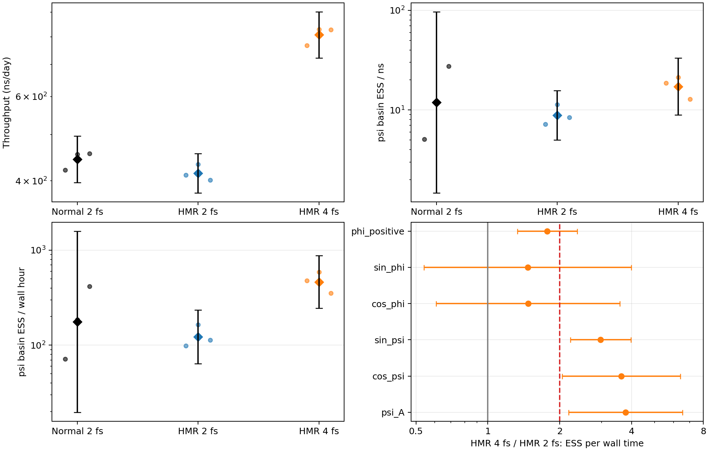
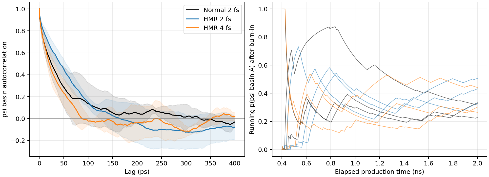
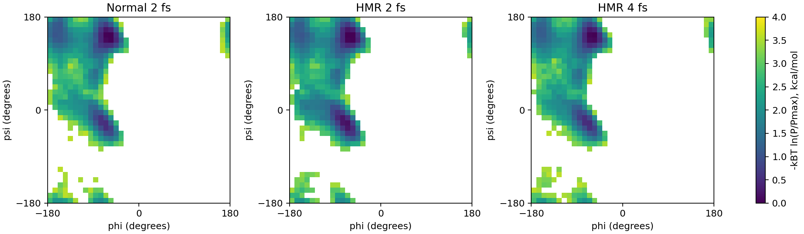

# HMR timestep and sampling efficiency: alanine dipeptide

## Interpretation of the 2026-11-07 local experiment

All nine 2 ns trajectories completed on one local RTX 4090, serially, for
18 ns total. The binary and native-input hashes, complete finite outputs,
intended runtime settings, common NVT box, sampled constraints and independent
coordinate-based phi/psi reference checks passed. This is a small-system
sampling experiment with the existing integrator, not a timestep-limit search.

Relative to ordinary masses at 2 fs, HMR at 4 fs gave **1.819x throughput**.
The sin(phi) effective-sample rate was **2.102x [1.623, 2.724]**, whereas the
primary psi-basin indicator gave **2.618x [0.195, 35.100]**. Brackets are
nominal 95% three-seed log-ratio repeatability intervals, not formal ESS-estimator
confidence intervals. The slow observable is much too uncertain to establish a
twofold gain. Effective samples of these observables are not independent samples
of the complete molecular ensemble.

Keeping HMR masses fixed and increasing 2 to 4 fs gave 1.945x throughput.
The corresponding effective-sample rate ratios were 3.777x [2.180, 6.544] for
the psi indicator and 1.473x [0.608, 3.572] for cos(phi). The diagnostic rates
depend on the observable and show substantial finite-trajectory uncertainty.

**Sampling-distribution equivalence has not been established.** HMR 4 fs minus
ordinary 2 fs gave a paired potential-energy difference of **-4.706 +/- 0.571
kcal/mol**; HMR 4 fs minus HMR 2 fs gave -4.175 +/- 3.57 kcal/mol (nominal
95% three-seed t intervals). Thus a measurable thermodynamic shift accompanies
the speed gain. This comparison does not establish which timestep is unbiased
or identify a defect in the mass-transfer algorithm. Population shifts and
incomplete slow-mode mixing also preclude an equivalence claim: psi split Rhat
was 1.0377-1.0773, each trajectory had only 8-44 primary effective samples, and
the positive-phi core was visited only zero or one time per trajectory.

The coarse phi/psi maps occupy similar regions, but their weights and rare
states are not converged. These results support a measured computational gain
and an observable-specific sampling benefit; they do not certify a universal
twofold gain at unchanged thermodynamic accuracy. No protein/FEP sampling or
physical kinetic-rate conclusion follows.

The public native fixture and reproducible commands are described in the
[benchmark guide](../../benchmarks/performance/hmr/README.md#alanine-dipeptide-sampling-efficiency).
[Machine-readable statistics and hashes](results.json) retain all nine runs.
Engine checkout: `32e91a91f4c8cfec621675777207ddfa2ee0d511`.
Binary SHA-256: `35de2e0c86c0abad28e77dcead399ff6dac6e07362b630dd392e7df05723a1ff`.

## Detailed methods and results

Public repository ACE–ALA–NME + 606 waters, 1840 atoms. Conventional NVT without enhanced-sampling bias potentials, 300 K, Middle Langevin tau 1 ps, identical original constraint selection, default double SETTLE + remaining SHAKE. HMR factors 2.0/2.5, water unchanged. No SITS or other enhanced sampling. This describes the simulation setup, not a claim of absence of finite-timestep bias.

Normal 2 fs versus HMR 2 fs isolates mass changes; HMR 2 versus 4 fs isolates timestep changes. Three velocity seeds start at the same prepared coordinates. Runs have equal physical durations and 0.1 ps CV output; first 20% excluded. Measured full production wall time includes initialization and discarded burn-in. ESS/ns uses retained physical time. This estimates ESS/wall rates; these were not fixed-wall-duration runs.

Primary observable: psi_A = I[cos(psi)>0], a periodic psi basin indicator. Secondary observables are sin/cos(phi/psi) and I[phi>0]. ESS is observable-specific, not an independent count of complete molecular configurations. Constant/unvisited indicators have undefined ESS. FFT covariance uses N normalization; Geyer initial positive/monotone paired sums, g>=1, ESS=N/g, tau_int=g*sample_interval/2. This is a per-trajectory estimator, not Stan's multi-chain ESS. Split Rhat is an ordinary, non-rank-normalized diagnostic on six half-chains. Core-state alternations use narrower cores A=[-90,45] and B=[90,180] union [-180,-150] degrees with gap observations removed; these are diagnostic counts, not kinetic rates.

[ESS method](https://mc-stan.org/docs/reference-manual/analysis.html); [molecular-simulation uncertainty and block-averaging guidance](https://pmc.ncbi.nlm.nih.gov/articles/PMC6286151/).

## Per-run diagnostics

| condition | seed | duration ns | wall s | ns/day | T K | U kcal/mol | p(psi_A) | core alternations | psi_A tau_int ps | psi_A ESS | ESS/hour | constraint error |
|---|---:|---:|---:|---:|---:|---:|---:|---:|---:|---:|---:|---:|
| Normal 2 fs | 812 | 2 | 410.06 | 421.4 | 300.29 | -5837.7 | 0.32579 | 35 | 98.271 | 8.1413 | 71.473 | 4.902e-06 |
| Normal 2 fs | 813 | 2 | 379.97 | 454.78 | 300.34 | -5838.2 | 0.33292 | 30 | 40.917 | 19.553 | 185.26 | 4.2675e-06 |
| Normal 2 fs | 814 | 2 | 378.68 | 456.33 | 300.08 | -5840.2 | 0.22886 | 33 | 18.238 | 43.867 | 417.04 | 4.9507e-06 |
| HMR 2 fs | 812 | 2 | 420.3 | 411.14 | 300.16 | -5839.3 | 0.50578 | 31 | 69.213 | 11.559 | 99.01 | 3.9495e-06 |
| HMR 2 fs | 813 | 2 | 399.27 | 432.79 | 299.98 | -5838.9 | 0.4316 | 39 | 43.968 | 18.196 | 164.07 | 3.8515e-06 |
| HMR 2 fs | 814 | 2 | 430.08 | 401.79 | 300.11 | -5839.3 | 0.32998 | 25 | 59.15 | 13.526 | 113.22 | 4.7421e-06 |
| HMR 4 fs | 812 | 2 | 225.38 | 766.69 | 300.31 | -5842.1 | 0.30154 | 46 | 26.813 | 29.838 | 476.6 | 3.7917e-06 |
| HMR 4 fs | 813 | 2 | 208.5 | 828.79 | 300.28 | -5843.1 | 0.4411 | 38 | 23.483 | 34.069 | 588.25 | 4.802e-06 |
| HMR 4 fs | 814 | 2 | 208.63 | 828.25 | 299.99 | -5845 | 0.26455 | 28 | 39.066 | 20.479 | 353.37 | 4.0446e-06 |

## Matched-seed speed ratios

Target/reference ratios use geometric means of the three seed ratios; intervals are nominal 95% Student-t repeatability intervals on log ratios (df=2), unadjusted for multiple comparisons. They describe between-seed variation, not a formal confidence interval for the ESS estimator. A wide interval is inconclusive, not evidence of equal efficiency.

| target / reference | observable | throughput ratio | ESS/ns ratio | ESS/hour ratio [95% interval] |
|---|---|---:|---:|---:|
| hmr_2fs/normal_2fs | psi_A | 0.935 | 0.741 | 0.693 [0.086, 5.614] |
| hmr_2fs/normal_2fs | cos_psi | 0.935 | 0.763 | 0.713 [0.096, 5.318] |
| hmr_2fs/normal_2fs | sin_psi | 0.935 | 1.008 | 0.942 [0.113, 7.831] |
| hmr_2fs/normal_2fs | cos_phi | 0.935 | 1.506 | 1.408 [0.866, 2.290] |
| hmr_2fs/normal_2fs | sin_phi | 0.935 | 1.531 | 1.431 [0.667, 3.069] |
| hmr_2fs/normal_2fs | phi_positive | 0.935 | 1.483 | 1.386 [0.931, 2.064] |
| hmr_4fs/hmr_2fs | psi_A | 1.945 | 1.941 | 3.777 [2.180, 6.544] |
| hmr_4fs/hmr_2fs | cos_psi | 1.945 | 1.863 | 3.624 [2.050, 6.408] |
| hmr_4fs/hmr_2fs | sin_psi | 1.945 | 1.525 | 2.967 [2.214, 3.976] |
| hmr_4fs/hmr_2fs | cos_phi | 1.945 | 0.757 | 1.473 [0.608, 3.572] |
| hmr_4fs/hmr_2fs | sin_phi | 1.945 | 0.755 | 1.469 [0.540, 3.993] |
| hmr_4fs/hmr_2fs | phi_positive | 1.945 | 0.912 | 1.775 [1.330, 2.368] |
| hmr_4fs/normal_2fs | psi_A | 1.819 | 1.439 | 2.618 [0.195, 35.100] |
| hmr_4fs/normal_2fs | cos_psi | 1.819 | 1.421 | 2.584 [0.202, 33.101] |
| hmr_4fs/normal_2fs | sin_psi | 1.819 | 1.537 | 2.796 [0.255, 30.685] |
| hmr_4fs/normal_2fs | cos_phi | 1.819 | 1.140 | 2.074 [1.375, 3.130] |
| hmr_4fs/normal_2fs | sin_phi | 1.819 | 1.156 | 2.102 [1.623, 2.724] |
| hmr_4fs/normal_2fs | phi_positive | 1.819 | 1.353 | 2.461 [1.239, 4.888] |

## Distribution and rare-state diagnostics

Mean +/- nominal 95% Student-t interval across the three seed means (df=2). Positive-phi observations are correlated, not independent visits. Phi core visits count entries into [30,150] degrees after filtering gaps between that core and [-150,-30], including an initially occupied positive core. Warning thresholds (ESS<50, fewer than 20 psi core alternations, 20 positive-phi observations or 10 positive-phi core visits) flag fragile estimates; passing them does not establish convergence.

| condition | T K | U kcal/mol | p(psi_A) | p(phi>0) |
|---|---:|---:|---:|---:|
| Normal 2 fs | 300.236 +/- 0.341 | -5838.68 +/- 3.25 | 0.295857 +/- 0.144 | 0.00670791 +/- 0.00647 |
| HMR 2 fs | 300.084 +/- 0.228 | -5839.21 +/- 0.591 | 0.422453 +/- 0.219 | 0.00529134 +/- 0.00699 |
| HMR 4 fs | 300.192 +/- 0.432 | -5843.38 +/- 3.63 | 0.335729 +/- 0.231 | 0.00587463 +/- 0.00121 |

Paired target-minus-reference differences (same seed; nominal 95% t repeatability intervals, df=2). These do not define an equivalence margin or prove absence of bias.

| target / reference | delta T K | delta U kcal/mol | delta p(psi_A) | delta p(phi>0) |
|---|---:|---:|---:|---:|
| hmr_2fs/normal_2fs | -0.152753 +/- 0.48 | -0.531342 +/- 3.13 | 0.126596 +/- 0.115 | -0.00141658 +/- 0.000936 |
| hmr_4fs/hmr_2fs | 0.108664 +/- 0.515 | -4.17506 +/- 3.57 | -0.0867237 +/- 0.269 | 0.000583297 +/- 0.00801 |
| hmr_4fs/normal_2fs | -0.0440887 +/- 0.14 | -4.7064 +/- 0.571 | 0.0398725 +/- 0.165 | -0.000833281 +/- 0.00756 |

| run | positive-phi observations | positive-phi core visits | warnings |
|---|---:|---:|---|
| production_normal_2fs_812 | 68/16001 | 0 | fewer than 10 positive-phi core visits; psi_A: undefined ESS or ESS below 50; cos_psi: undefined ESS or ESS below 50; sin_psi: undefined ESS or ESS below 50 |
| production_normal_2fs_813 | 103/16001 | 1 | fewer than 10 positive-phi core visits; psi_A: undefined ESS or ESS below 50; cos_psi: undefined ESS or ESS below 50; sin_psi: undefined ESS or ESS below 50 |
| production_normal_2fs_814 | 151/16001 | 0 | fewer than 10 positive-phi core visits; psi_A: undefined ESS or ESS below 50; cos_psi: undefined ESS or ESS below 50 |
| production_hmr_2fs_812 | 39/16001 | 0 | fewer than 10 positive-phi core visits; psi_A: undefined ESS or ESS below 50; cos_psi: undefined ESS or ESS below 50; sin_psi: undefined ESS or ESS below 50 |
| production_hmr_2fs_813 | 86/16001 | 0 | fewer than 10 positive-phi core visits; psi_A: undefined ESS or ESS below 50; cos_psi: undefined ESS or ESS below 50; sin_psi: undefined ESS or ESS below 50 |
| production_hmr_2fs_814 | 129/16001 | 0 | fewer than 10 positive-phi core visits; psi_A: undefined ESS or ESS below 50; cos_psi: undefined ESS or ESS below 50; sin_psi: undefined ESS or ESS below 50 |
| production_hmr_4fs_812 | 98/16001 | 0 | fewer than 10 positive-phi core visits; psi_A: undefined ESS or ESS below 50; cos_psi: undefined ESS or ESS below 50; sin_psi: undefined ESS or ESS below 50 |
| production_hmr_4fs_813 | 99/16001 | 1 | fewer than 10 positive-phi core visits; psi_A: undefined ESS or ESS below 50; cos_psi: undefined ESS or ESS below 50; sin_psi: undefined ESS or ESS below 50 |
| production_hmr_4fs_814 | 85/16001 | 0 | fewer than 10 positive-phi core visits; psi_A: undefined ESS or ESS below 50; cos_psi: undefined ESS or ESS below 50; sin_psi: undefined ESS or ESS below 50 |

Small dots are seed values; diamonds are geometric means with nominal 95% three-seed log-scale repeatability intervals. Axes use logarithmic scales. Right-bottom intervals use paired log ratios; dashed line marks 2x.

ACF shading is one between-seed SD. Running populations show each seed separately after the discarded first 20%.

Bins with fewer than five combined observations are masked. These are finite-sample occupancy maps, not converged free-energy surfaces.

## Stationarity and limits

| condition | observable | split Rhat |
|---|---|---:|
| normal_2fs | psi_A | 1.0734641829276157 |
| normal_2fs | cos_psi | 1.0748407118654124 |
| normal_2fs | sin_psi | 1.0644750012910944 |
| normal_2fs | cos_phi | 1.0063041405104654 |
| normal_2fs | sin_phi | 1.0079286518491466 |
| normal_2fs | phi_positive | 1.0005323897219904 |
| hmr_2fs | psi_A | 1.0773361378173671 |
| hmr_2fs | cos_psi | 1.0766273861453386 |
| hmr_2fs | sin_psi | 1.0575576507710422 |
| hmr_2fs | cos_phi | 1.0193407552576055 |
| hmr_2fs | sin_phi | 1.0151508552281492 |
| hmr_2fs | phi_positive | 1.0006282781142801 |
| hmr_4fs | psi_A | 1.0376556812022852 |
| hmr_4fs | cos_psi | 1.0386876857788492 |
| hmr_4fs | sin_psi | 1.0340918980328464 |
| hmr_4fs | cos_phi | 1.0175609626443765 |
| hmr_4fs | sin_phi | 1.0105757463545422 |
| hmr_4fs | phi_positive | 1.000408578779023 |

### Primary ESS estimator sensitivity

Nonoverlapping batch means provide an independent variance-estimator cross-check. Each block size needs at least eight batches; long blocks still have large uncertainty and short blocks may miss slow correlation. Geyer truncation is a practical single-series estimate for these MD observables, not a convergence theorem for inertial Langevin trajectories. Agreement between estimators does not prove convergence.

| run | Geyer ESS | 50 ps batch ESS | 100 ps batch ESS | 200 ps batch ESS |
|---|---:|---:|---:|---:|
| production_normal_2fs_812 | 8.1413 | 45.13 | 25.467 | 14.194 |
| production_normal_2fs_813 | 19.553 | 44.203 | 27.016 | 15.525 |
| production_normal_2fs_814 | 43.867 | 61.498 | 64.3 | 61.436 |
| production_hmr_2fs_812 | 11.559 | 43.826 | 27.178 | 19.422 |
| production_hmr_2fs_813 | 18.196 | 42.977 | 28.546 | 17.658 |
| production_hmr_2fs_814 | 13.526 | 38.891 | 20.947 | 15.146 |
| production_hmr_4fs_812 | 29.838 | 63.138 | 34.388 | 33.632 |
| production_hmr_4fs_813 | 34.069 | 50.781 | 39.452 | 49.043 |
| production_hmr_4fs_814 | 20.479 | 44.371 | 24.82 | 22.107 |

Ratios are interpretable only for observables with adequate transitions and stable populations. ESS for a rapidly fluctuating observable does not establish sampling of rare phi-positive states or other slow modes. A small split Rhat is not a proof of convergence. Equal populations within uncertainty are not an equivalence test; timestep bias must be assessed separately. Constraints are checked only in stored float32 frames at 10 ps intervals. No general FEP, protein, kinetic-rate, or universal timestep conclusion follows from this small system.
