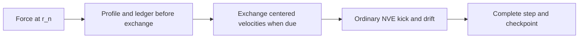

> 本分支输入与代码职责已更新，当前接口见 [动力学组件](dynamics-components.md)。下文保留旧版方法推导/验证记录，其中 `[viscosity]`、`[[coupling]]` 需先由 Python 工作流展开。

# RNEMD momentum exchange and viscosity diagnostics

This path implements an unconstrained atomic Müller–Plathe-style momentum
exchange, a spatial velocity profile and an explicit-window analyzer. It is
not yet a converged liquid-viscosity benchmark. See also [external coupling](nonequilibrium-coupling.md),
[cosine flow](nonequilibrium-cosine.md), and [Green–Kubo](nonequilibrium-green-kubo.md).

## Input and supported scope

Add to a complete, equilibrated periodic model:

```toml
[viscosity]
method = "rnemd"
exchange_interval = 100   # REQUIRED; integration steps, one pair per attempt
bins = 20                 # default 20; even, 4..10000
flow = "x"                # default x
gradient = "z"           # default z; must differ from flow
sample_interval = 1       # default 1; independent of exchange/mdout cadence
output = "viscosity.h5"   # default; a new file, including on continuation
```

The interval above illustrates syntax, not a recommended physical driving rate.
Unknown keys and explicit `[[coupling]]` alongside RNEMD are rejected. There is
one active viscosity method per run. Use separate runs for a method comparison.

Current runtime: single MPI rank; at least two positive-mass particles;
fixed orthogonal periodic box; unconstrained NVE; no virtual sites, variable
charges, SITS, clipping, walls, external bias or force plugins. Charged cells
must be neutral and use both direct nonbonded and reciprocal PME each step,
as described in the GK documentation. Pressure-based and MC barostats are
explicitly disallowed. This does not add a new thermostat or deform the box.

A swap between unconstrained particles conserves their centered kinetic energy
and total momentum in exact arithmetic, including unequal masses. Constraint
projection can change transferred momentum; constrained water and rigid-molecule
RNEMD remain unsupported. Flexible bonded particles follow the same atomic
exchange, but molecular transport accuracy still needs independent validation.

## Geometry, exchange and time integration

The periodic gradient coordinate is partitioned into equal bins. Bin 0 and bin
`bins/2` exchange one pair: largest nonnegative flow velocity in bin 0, smallest
nonpositive flow velocity in the middle bin. Ties use the lowest global atom ID.
An empty exchange slab and absent signed candidates are counted separately.
Zero transfer or transfer unresolved at engine float precision is also counted
as `no_candidate`; no velocity is written in those cases.

```text
z = 0                L/2                      L
    bin 0             middle                   bin 0 (periodic)
    loses +px         gains +px                loses +px
         <---- momentum transport ---->
ux: low  / / / / / / high \ \ \ \ \ \ low
         slope g1 > 0       slope g2 < 0
```

SPONGE stores incoming leapfrog half-step velocities. After evaluating the force
at `r_n`, reconstruct the velocity at `t_n`:

\[
u_i=v_{i,n-1/2}+\frac{\Delta t}{2m_i}F_i(r_n).
\]

For selected particles `a,b`, reflect only their flow components about their
mass-weighted center of mass:

\[
u_c=\frac{m_a u_a+m_b u_b}{m_a+m_b},\qquad
u'_a=2u_c-u_a,\quad u'_b=2u_c-u_b.
\]

Apply `u'_i-u_i` to the stored half-step velocity, then execute the ordinary
full force kick and drift. No extra force evaluation is needed. The exchange
is a discrete drive; centered kinetic energy is conserved at the impulse,
while stored half-step kinetic energy need not be.



Exchange is due at positive global steps divisible by `exchange_interval`;
step zero is not exchanged. The sampled momentum at `t_n` includes only earlier
exchanges. An interval `[t_a,t_b]` measures impulses at `t_a` through those
strictly before `t_b`.

Profile sampling must resolve the flow between exchanges. Sampling only every
exchange interval locks every observation to the pre-exchange phase; it is not
automatically a time average. In a bounded 108-atom LJ comparison, this markedly
underestimated the velocity gradient and overestimated viscosity. Keep the
exchange and sampling intervals independent, and check sampling convergence
against denser output. The runtime default remains one sample per step. A
smaller interval alone does not establish steady state or linear response.

Actual float velocity increments determine the recorded middle-particle impulse.
`momentum_error` is the sum of the two actual impulses; `energy_error` is the
corresponding centered kinetic-energy change. Monitor both in long runs. The
host gather and double reductions are a correctness implementation, with no
GPU throughput claim.

## Output and restart

The existing `ObservableH5Writer` writes contract
`sponge.rnemd.centered_nve.v1`, common step/time, units, configuration and a
completion journal. Each frame contains:

| Fields | Units and meaning |
|---|---|
| `bin_i_count`, `bin_i_mass`, `bin_i_momentum` | count, Da, Da nm/ps; centered flow momentum |
| `momentum` | Da nm/ps; cumulative positive momentum gained by middle slab |
| `momentum_error`, `energy_error` | Da nm/ps, kcal/mol; cumulative exchange residuals |
| `attempts`, `swaps`, `empty`, `no_candidate` | cumulative counts |
| `area`, `length` | nm² and nm; transverse area and gradient length |
| `kinetic_temperature` | K; centered global-COM-subtracted, `3N−3` DOF |
| `thermal_temperature` | K; per-bin mean flow and transverse global COM removed, `3N−occupied_bins−2` DOF |

Temperature uses squared residuals to avoid cancellation of large flow energies.
It does not thermostat the system. Empty bins have zero mass/momentum/count and
no defined velocity. Binning affects the thermal estimate and needs a resolution
check.

`Measurement` owns the compensated impulse sum. The existing restart coupling
map carries method, configuration, dt/time, completed steps, counters and
residuals; all fields participate in the restart hash. Dynamic restart rejects
changed/removed RNEMD, missing state, changed exchange interval or mismatched
dt/time. Global exchange/sample cadence continues. Native coordinate restart
alone cannot preserve the ledger; structural loading deliberately starts a new
experiment. Each continuation writes a new profile file. The current analyzer
accepts one segment only.

## Analysis

```sh
python scripts/analyze_rnemd.py viscosity.h5 \
  --start-ps 100 --block-ps 50 --exclude-neighbors 0 --output analysis
```

These times illustrate syntax. NumPy and h5py are required. The reader rejects
incomplete files, completion-history mismatch, nonuniform time, invalid units,
nonfinite values, inconsistent populations/counters and changing geometry.
The output directory must be new.

After an explicit startup cutoff, use equal-duration blocks with both endpoint
samples. Momentum flux is

\[
J=\frac{P(t_b)-P(t_a)}{2A(t_b-t_a)}.
\]

The denominator includes two periodic transport paths. Bin velocity is the ratio
of trapezoid-averaged momentum to trapezoid-averaged mass over the same interval.
Fit the branches separately with equal spatial-bin weights. Always omit both
exchange bins; `exclude_neighbors` additionally omits that many adjacent bins
on each side. Each branch needs at least two retained bins, so four runtime bins
are insufficient for this analyzer. With only two fitted bins, zero residual
provides no evidence of linearity.

For positive middle-slab impulse and the coordinate convention above:

\[
\eta_1=J/g_1,\qquad \eta_2=-J/g_2,
\quad g_1>0,\ g_2<0.
\]

Use `1 Da nm/ps = 1.66053906660e−24 kg m/s`, area in m², time in seconds,
and `1 ps⁻¹ = 10¹² s⁻¹`. The versioned estimator
`aggregate-profile-equal-branch-fluidity.v2` first pools mass, momentum and
impulse across the full retained window, then fits the two aggregate profiles.
It uses fixed equal branch weights for the inverse viscosity (fluidity):

\[
\phi_1=g_1/J,\quad\phi_2=-g_2/J,\qquad
\widehat\eta=\left[(\phi_1+\phi_2)/2\right]^{-1}.
\]

This replaces the earlier average of per-block viscosity ratios. Taking inverses
of noisy small block gradients can strongly bias that average. Individual block
slopes and ratios remain diagnostic output; they do not enter the point estimate
as already formed ratios. Pooling equal-duration trapezoid block means exactly
reproduces the full-window trapezoid, including shared boundary half weights.

Bootstrap resamples **the same whole-block indices** for mass, momentum and
impulse, and refits every sampled profile. It preserves branch/flux/profile
covariance and keeps negative fluidities. Positive lower 95% fluidity bounds
for both branches and their average are required for a finite viscosity interval;
the common interval is inverted with reversed endpoints. If a bound includes
zero, the viscosity interval is `null` and status is `unresolved_response`.
Undefined draws (zero flux or an empty fitted bin) invalidate the interval;
they are counted and never filtered away. A wrong-sign aggregate branch also
leaves the point viscosity `null`. Fully empty fitted bins or zero flux across
the entire analysis window remain input/coverage errors. `diagnostic_only`
means a finite conditional interval, not scientific validation.

`summary.json` retains aggregate and per-block fits, both branch responses,
fluidity intervals, invalid/nonpositive draw counts, flux, endpoints, skip
counts, conservation residuals, temperatures, input/script SHA256 and dependency
versions. `profiles.csv` retains each block's bin means; JSON also contains the
full-window profile. The interval assumes approximately independent blocks;
adjacent blocks share endpoint samples. It excludes finite-drive/size/timestep,
fitting-range and force-field bias. Fewer than ten blocks triggers a warning.
There is no automated steady-state, linear-response or convergence PASS.

## Evidence and references

Tests cover unequal-mass conservation, global-ID ties, periodic wrapping, empty
slabs, signed selection, centered finite-timestep exchange under a harmonic
bond, sparse sampling, strict input rejection and exact equal-time full/split
restart profiles and ledger. The analyzer uses synthetic triangular flow with
known SI viscosity to test units, covariance, exclusions and HDF5/CLI contracts.
Those fixtures are not MD or experimental observations. The two-particle runnable
example checks exchange only and has no liquid-viscosity interpretation.

The method follows Müller–Plathe, *Phys. Rev. E* **59**, 4894–4898 (1999),
[DOI:10.1103/PhysRevE.59.4894](https://doi.org/10.1103/PhysRevE.59.4894).
[LAMMPS fix viscosity](https://docs.lammps.org/fix_viscosity.html) documents
unequal-mass conservation, the two-path factor and the restriction on constrained
atoms. SPONGE uses its own centered-leapfrog placement and restart ledger;
cross-engine tests must align velocity phase and cumulative-sign conventions.

Scientific acceptance still needs equilibrated LJ liquids, independent replicas,
weak-driving/size/dt/block/fitting-range scans, GK/cosine/RNEMD agreement under
predeclared equivalence criteria, same-model LAMMPS comparison, total cost at
target precision, and molecular/experimental predictions.
